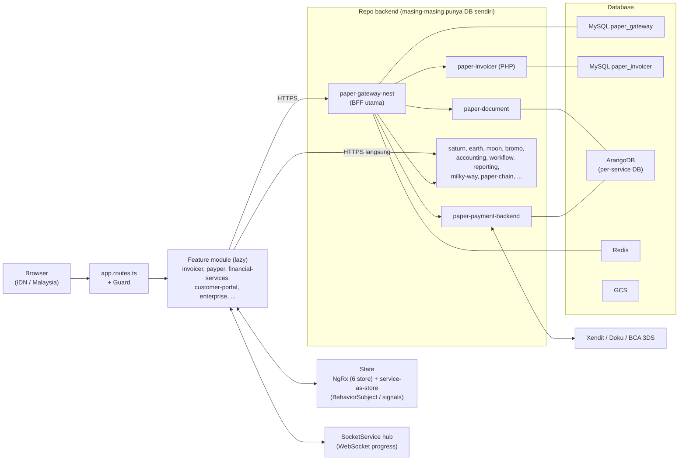
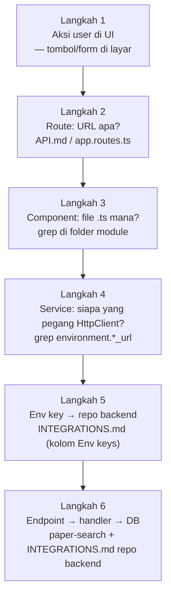
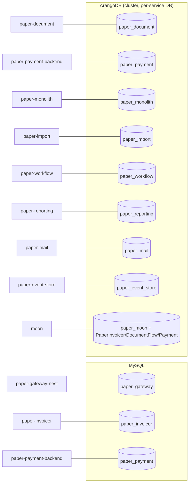
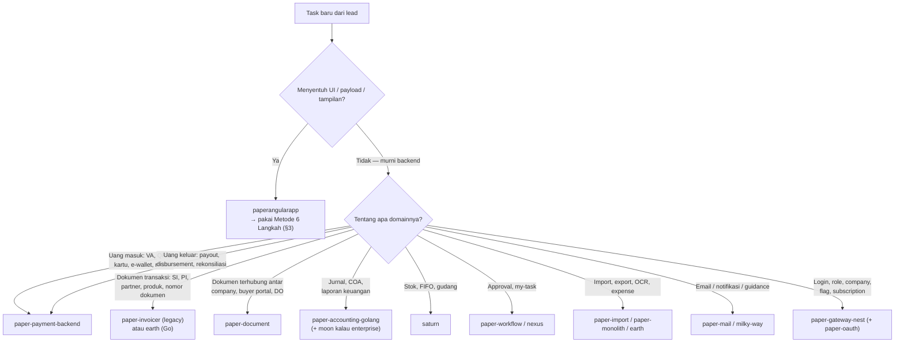
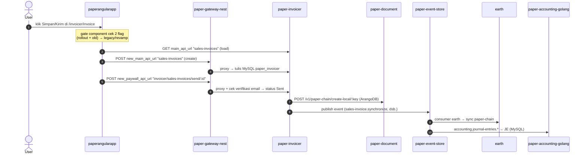
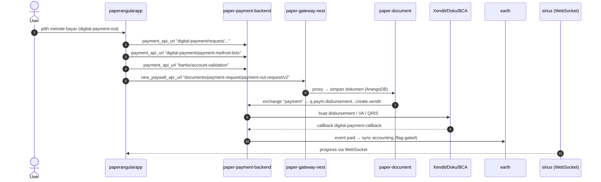
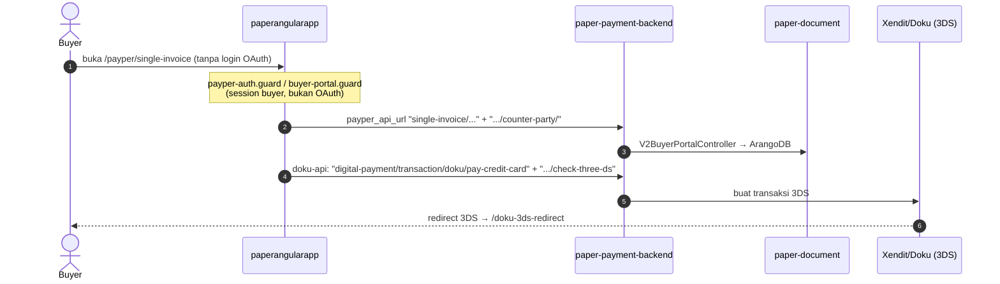
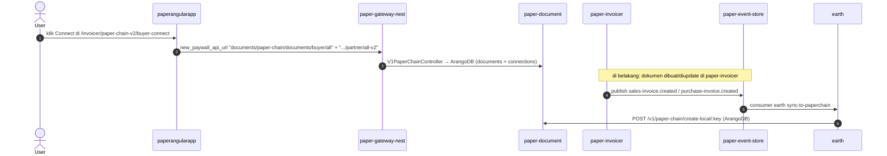

# Peta Flow paperangularapp — Onboarding Engineer Baru

> **File tunggal untuk memahami semua flow.** Semua flow Paper.id bersumber dari paperangularapp
> (SPA Angular 19): setiap aksi user di browser berakhir sebagai HTTPS call ke satu atau lebih
> repo backend, dan setiap repo backend punya database sendiri. Dokumen ini mengajarkan
> (1) cara melacak flow apa pun dari klik pertama sampai database, (2) peta semua menu → repo
> backend → database, (3) domain ownership tiap service + peta "task dari lead → kerja di mana",
> dan (4) 4 contoh trace nyata end-to-end dengan flowchart.

---

## Daftar Isi

1. [Kenapa Mulai dari paperangularapp](#1-kenapa-mulai-dari-paperangularapp)
2. [Peta Besar Arsitektur](#2-peta-besar-arsitektur)
3. [Metode 6 Langkah Melacak Flow](#3-metode-6-langkah-melacak-flow)
4. [Peta Menu → Module → Repo Backend](#4-peta-menu--module--repo-backend)
5. [Peta Service → Database (+ Domain Ownership & Task Routing)](#5-peta-service--database)
6. [Worked Example 1: Sales Invoice](#6-worked-example-1-sales-invoice-create--save--send)
7. [Worked Example 2: Purchase Invoice + Digital Payment-Out](#7-worked-example-2-purchase-invoice--digital-payment-out)
8. [Worked Example 3: Payper (Pembayaran Buyer)](#8-worked-example-3-payper-pembayaran-buyer)
9. [Worked Example 4: Paper-Chain Connect](#9-worked-example-4-paper-chain-connect)
10. [Tools, Perangkap, dan Cheat Sheet](#10-tools-perangkap-dan-cheat-sheet)

> **Baru di Paper.id?** Jangan baca semuanya. Jalur baca:
> - **15 menit pertama:** §1 (kenapa mulai dari sini) + §1a (kamus istilah) → §2 (diagram
>   arsitektur) → §3 (metode 6 langkah) → §5b (peta keputusan "task → kerja di mana").
> - **Jam pertama:** tambahkan Worked Example 1 (§6) dibaca sambil membuka file-nya di repo.
> - **Sisanya = kamus referensi.** Tidak perlu dihafal; buka saat dibutuhkan.

---

## 1. Kenapa Mulai dari paperangularapp

**paperangularapp adalah satu-satunya pintu masuk (single entry point) bagi pengguna browser.**
Semua produk Paper.id — invoicing, pembayaran, KYC, financial services, paper-chain, portal
pembeli (payper / customer-portal), paywall, multi-company, enterprise — hidup dalam satu SPA ini.
Konsekuensinya:

- SPA **tidak punya database sendiri**. Ia hanya menyusun payload dari form/UI, mengirim HTTPS ke
  backend, dan menampilkan hasil. Kalau payload salah, backend salah tulis data — maka banyak bug
  "backend" sebenarnya dimulai dari sini.
- **Setiap aksi user = 1 atau lebih HTTP call** ke repo backend. Repo backend itulah yang punya
  database. Jadi memahami flow = memahami rantai: **UI → route → component → service → env key →
  repo backend → endpoint → DB**.
- Karena semua flow berangkat dari sini, dokumen ini dan repo paperangularapp adalah titik awal onboarding
  yang paling efisien: dari satu tempat kamu bisa menemukan semua repo dan DB yang terlibat.

### 1a. Kamus cepat — istilah yang muncul di mana-mana

| Istilah | Arti |
|---|---|
| **SI / PI** | Sales Invoice (invoice penjualan) / Purchase Invoice (invoice pembelian) |
| **DP** | Down Payment (uang muka) |
| **DO** | Delivery Order (surat jalan) |
| **PO / SO** | Purchase Order / Sales Order |
| **JE** | Journal Entry (jurnal akuntansi) — dibuat otomatis dari event dokumen |
| **COA** | Chart of Accounts (bagan akun) |
| **AR / AP** | Accounts Receivable (piutang) / Accounts Payable (hutang) |
| **VA** | Virtual Account — nomor rekening sekali-pakai untuk terima pembayaran (BCA, BNI, dll.) |
| **3DS** | 3-D Secure — verifikasi OTP kartu kredit; alasan ada route `*-3ds-redirect` |
| **Disbursement** | Pencairan/payout dana ke rekening supplier |
| **Reconciliation** | Mencocokkan mutasi bank dengan pembayaran tercatat |
| **BFF** | Backend for Frontend — gateway yang jadi satu pintu API SPA (paper-gateway-nest) |
| **System of record** | DB sumber kebenaran untuk satu jenis data (mis. `paper_invoicer` untuk invoice) |
| **Event / consumer / queue** | Pesan RabbitMQ: satu service *publish* event, service lain *consume* dan bereaksi |
| **Exchange / routing key** | Alamat topik & label pesan RabbitMQ (lihat EVENTS.md tiap repo) |
| **Fan-out** | Satu event disebarkan ke banyak consumer sekaligus (invoice dibuat → sync, JE, notif) |
| **DLQ** | Dead Letter Queue — tempat pesan yang gagal diproses; cek dini saat "data tidak masuk" |
| **Gate component** | Component yang memilih render legacy vs revamp berdasar feature flag |
| **Feature flag** | Saklar rollout per company/user (migrasi revamp, fitur berbayar) |
| **Canary** | Jalur rollout bertahap — nama muncul di exchange/queue (`canary.document...`) |
| **Interceptor** | Middleware HTTP Angular (refresh token, loader) — semua request melewatinya |
| **Sinkron vs asinkron** | Sinkron = HTTP request-response langsung; asinkron = lewat event, UI sudah selesai tapi data menyusul |

---

## 2. Peta Besar Arsitektur



Tiga takeaway:

1. **paper-gateway-nest adalah gerbang utama.** Sebagian besar feature module bicara ke satu BFF.
   Env key lama (`main_api_url`) dan baru (`new_main_api_url`, `new_gateway_url`,
   `new_paywall_api_url`) hidup berdampingan selama migrasi.
2. **State sengaja hybrid.** Hanya 6 NgRx store; sisanya service-as-store (BehaviorSubject/signal).
   Cek pola yang ada dulu sebelum menambah plumbing baru.
3. **Banyak service backend saling memanggil + bertukar event via RabbitMQ** (dipublish lewat
   paper-event-store). Satu klik di UI bisa memicu rantai async panjang — fan-out terjadi di
   backend, bukan di browser.
4. **Tidak semua data datang via HTTP response.** Data realtime masuk lewat WebSocket
   (SocketService hub → sirius / paper-application-status) dan push notification CleverTap.
   Detail langganan per feature: `EVENTS.md`.
5. **Browser juga memuat SDK third-party, dan app hidup di 2 region.** Analytics: GA + CleverTap
   + Facebook Pixel; anti-fraud: FingerprintJS; 3DS: Xendit/Doku/BCA. Region Indonesia dan
   Malaysia masing-masing punya environment sendiri di `src/environments/`.

---

## 3. Metode 6 Langkah Melacak Flow

Setiap flow bisa dilacak dengan rantai pertanyaan yang sama. Bayangkan user klik "Simpan" pada
form apapun:



### 3a. Cara tercepat: jangan baca kode dulu — buka DevTools Network

Metode 6 langkah di atas itu *code-first*. Tapi ada jalan pintas yang sering lebih cepat untuk
pertanyaan "klik ini sebenarnya nge-hit repo mana?":

1. Buka app (mis. staging), tekan **F12 → tab Network**, centang **Fetch/XHR**.
2. Lakukan aksinya (klik Simpan, buka menu, dll.).
3. Lihat request yang muncul → **URL prefix-nya langsung menunjuk repo** (tabel di bawah).
4. Mau lihat payload yang dikirim frontend? Klik request → tab **Payload/Request** — ini penting,
   karena payload salah adalah penyebab bug paling umum.
5. Status 4xx/5xx? Response body-nya biasanya menyebut nama service yang menolak.

**Tabel konversi prefix URL (yang terlihat di Network tab) → repo:**

| Prefix URL di request | Repo backend |
|---|---|
| `/oauth/access_token` | paper-oauth |
| `gateway_url`, `gateway_v2_url`, `new_gateway_url`, `new_main_api_url`, `new_paywall_api_url` | paper-gateway-nest (proxy — lihat path setelah prefix untuk tahu downstream) |
| `/api/v1/invoicer/` (`main_api_url`) | paper-invoicer (legacy) |
| `/api/v1/payment-api/`, `payper_api_url`, `digital_payment_url`, `new_payment_va_url` | paper-payment-backend |
| `/api/v1/documents/`, `document_v2_url`, `files_api_url` | paper-document |
| `/api/v1/saturn/` | saturn |
| `/api/v1/accounting-golang/` | paper-accounting-golang |
| `/api/v1/accounting/` | paper-accounting (PHP legacy) |
| `/api/v1/finance/` | paper-finance-golang |
| `/api/v1/earth/` | earth |
| `/api/v1/moon/` | moon |
| `/api/v1/bromo/` | bromo |
| `/celestial/api/v1/` | celestial |
| `/api/v1/workflow/` | paper-workflow |
| `/api/v1/reporting/` | paper-reporting |
| `/api/v1/import-data/` | paper-import |
| `/api/v1/inventory/` | paper-inventory |
| `paper_chain_url` (`/api/v1/`) | paper-chain |
| `/api/v2/borrower/`, `/api/v2/financing-companies/` | paper-borrower / financing-companies |
| `milky_way_url`, `new_milky_way_url`, `milky_api_url` | milky-way |

> Hati-hati: gateway alias (`new_gateway_url`, `new_paywall_api_url`) menelan banyak path —
> request ke `.../documents/...` lewat gateway sebenarnya mendarat di **paper-document**. Kalau
> ragu, cocokkan **path**-nya dengan daftar proxy di `paper-gateway-nest/API.md`.

### Langkah 1 — Aksi user di UI

Mulai dari gejala: tombol, form, dialog. Nama menu di sidebar → nama folder module di
`src/app/` (mis. menu Invoice Penjualan → `src/app/invoicer/invoice/` atau `sales-invoice/`).

### Langkah 2 — Route: URL apa?

Buka `API.md` (peta route + guard) atau langsung `src/app/app.routes.ts` +
`src/app/invoicer/invoicer.routes.ts`. Perhatikan **guard**-nya — guard menentukan session apa
yang dibawa request (OAuth user vs payper buyer session vs anonymous deep link).

### Langkah 3 — Component: file .ts mana?

Dari folder module, cari component yang menangani aksi tersebut. Dua tips:

- Pola "gate": route root sering berupa gate component yang memilih legacy vs revamp
  (mis. `sales-invoice-gate.component.ts` membaca 2 feature flag). Kalau form yang kamu lihat di
  browser beda dari yang diexpect, cek dulu komponen mana yang sedang dirender flag.
- `grep -rn "namaTombol\|namaAksi" src/app/<module> --include="*.ts"`.

### Langkah 4 — Service: siapa yang pegang HttpClient?

Component jarang memanggil HTTP langsung; cari service yang di-inject. Gunakan grep env key
(ini trik paling cepat, karena semua base URL berasal dari `src/environments/environment.ts`):

```bash
grep -rn "environment\." src/app/<module> --include="*.ts" \
  | grep -oE "environment\.[a-z_0-9]+" | sort | uniq -c | sort -rn
```

Hasilnya = daftar env key yang dipakai module tersebut. Lalu lihat path endpoint di belakangnya:

```bash
grep -rn "main_api_url" src/app/<module> --include="*.ts" \
  | grep -oE "main_api_url\}?[^'\`\"]*" | sort | uniq -c | sort -rn
```

### Langkah 5 — Env key → repo backend

Cocokkan env key dengan `INTEGRATIONS.md` (bagian "Outbound — Paper.id backend services"):
tiap service punya daftar Env keys. Ini konversi "URL di kode" → "repo GitHub yang di-hit".

### Langkah 6 — Endpoint → handler → DB

Sampai sini kamu tahu repo backend + path endpoint-nya. Untuk melanjutkan ke handler dan
database:

- **Buka repo backend tersebut dan baca `INTEGRATIONS.md`-nya.** Semua repo Paper.id memakai
  pola 4-file (`CLAUDE.md` / `API.md` / `EVENTS.md` / `INTEGRATIONS.md`). INTEGRATIONS.md repo
  backend mendokumentasikan **database yang dia punya** + semua service lain yang dia panggil.
- Gunakan **`/paper-search`** (RAG lintas semua repo Paper.id) untuk menemukan handler endpoint:
  `python3 ... "digital payment request handler mongo collection"` → langsung keluar file handler
  + collection-nya.
- Gunakan **`/paper-investigate`** kalau pertanyaannya "kenapa X terjadi" lintas service — skill
  ini melakukan investigasi terstruktur dengan konfirmasi Grep/Read.

---

## 4. Peta Menu → Module → Repo Backend

> Tabel ini hasil reverse dari `INTEGRATIONS.md` (kolom "Used by") + `API.md`. Ini kamus pertama
> yang kamu buka saat dapat tiket: "menu X error" → langsung tahu module + repo mana yang dicurigai.

| Menu / Surface | Route | Module (`src/app/`) | Repo backend yang di-hit |
|---|---|---|---|
| Login / Register / Reset password | `/login`, `/register`, ... | `auth/` | paper-oauth (`auth_url`) |
| Dashboard v2 | `/dashboard` | `v2/` | paper-gateway-nest, internal-dashboard |
| Invoice Penjualan (SI) | `/invoicer/invoice` | `invoicer/invoice/`, `invoicer/sales-invoice/` | paper-invoicer via gateway (`main_api_url`/`new_main_api_url`), earth (sync/export), paper-document, paper-workflow |
| Invoice Pembelian (PI) + payment-out | `/invoicer/purchase-invoice` | `invoicer/purchase-invoice/` | paper-invoicer, paper-document, paper-payment-backend, accounting-golang, sirius (WS progress) |
| Partner / Mitra | `/invoicer/partner` | `invoicer/partner/` | paper-invoicer (`main_api_url}partners`), earth |
| Produk | `/invoicer/product` | `invoicer/product/` | saturn (`saturn_api_url`), paper-invoicer |
| Inventory / Stok | `/invoicer/inventory` | `invoicer/inventory/` | paper-inventory (`inventory_api_url`), saturn |
| Accounting | `/invoicer/accounting` | `invoicer/accounting/` | paper-accounting-golang (`accounting_golang_api_url`), paper-accounting (legacy) |
| Laporan (Report) | `/invoicer/report` | `invoicer/report/` | paper-reporting (`reporting_url`), earth (export) |
| Pembayaran (payment) | `/invoicer/payment` | `invoicer/payment/` | paper-payment-backend (`payment_api_url`) |
| Digital payment-out (finance) | `/invoicer/finance` | `invoicer/finance/digital-payment-out/` | paper-payment-backend (`digital_payment_url`), paper-document via gateway (`new_paywall_api_url}documents/payment-request/...`) |
| Purchase Order | `/invoicer/purchase-order` | `invoicer/purchaseOrder/`, `purchase-order/` (revamp) | paper-invoicer (`main_api_url}purchase-orders`), paper-inventory (`inventory_api_url`), earth |
| Sales Order | `/invoicer/sales-order` | `invoicer/salesOrder/`, `sales-order/` (revamp) | paper-invoicer (`main_api_url`/`new_main_api_url`), earth |
| Import dokumen/invoice | `/invoicer/import-document` | `invoicer/import-document/` | paper-import (`paper_import_url`), bromo (Accurate) |
| Workflow approval | `/invoicer/workflow` | `invoicer/workflow/` | paper-workflow (`workflow_api_url`), nexus — flag `approval-workflow` |
| Paper-chain (v2 buyer-connect) | `/invoicer/paper-chain-v2/buyer-connect` | `invoicer/paper-chain-v2/` | paper-document via gateway (`new_paywall_api_url}documents/paper-chain/...`), earth (event sync) |
| Paper-chain v3 | `/invoicer/paper-chain-v3` | `paper-chain/` | paper-chain (`paper_chain_url`), paper-document |
| Payper (bayar sebagai buyer) | `/payper/**` | `payper/` | paper-payment-backend (`payper_api_url`), paper-document (buyer portal), gateway |
| Customer portal | `/customer-portal/:id` | `customer-portal/` | gateway, paper-document |
| Enterprise (multi-entity) | `/invoicer/enterprise/**` | `enterprise/` | paper-invoicer via gateway, moon |
| KYC / digital-kyc | (dari invoicer) | `kyc/`, `digital-kyc/` | gateway (KYC native), milky-way |
| Paywall / subscription | `/paywall` | `paywall-revamp/` | paywall (`paywall_api_url`), payment-backend (App Store IAP) |
| Multi-company | `/multi-company` | `multi-company/` | gateway (companies), milky-way |
| Financial services | `/financial` | `financial-services/` | paper-borrower (`borrower_url`), financing-companies |
| Paper-card | `/invoicer/paper-card`, `/paper-card-uploader` | `paper-card/` | paper-payment-backend, gateway |
| Settings | `/invoicer/settings` | `invoicer/settings/` | gateway, moon, earth (template invoice), paper-accounting |
| Notifikasi / guidance | `/invoicer/notifications` | — | milky-way |
| Referral / promotion | `/invoicer/referral` | — | promotion (`promotion_url`), milky-way |
| 3DS callbacks | `/doku-3ds-redirect`, `/bca-card-3ds-redirect` | `invoicer/doku/`, payment | paper-payment-backend (3DS via Doku/BCA) |
| Digital payment-out dashboard | `/invoicer/digital-payment` | `digital-payment/` | paper-payment-backend + paper-document via gateway — panggilan lewat service `invoicer/finance/digital-payment-out/` |
| Reconciliation | (mounted dari invoicer) | `reconciliation/` | **earth** (`earth_url`, 11 pemakaian) — NgRx store `paymentReconciliation` |
| Bulk payment view | (mounted dari invoicer) | `bulk-invoices-payment-view/` | via service bersama (ringkasan pembayaran bulk; payment-backend) |
| Shared PI viewer (publik) | `/shared-purchase-invoice` | `shared-purchase-invoice/` | viewer publik; panggilan via service bersama |
| Supplier connection landing | `/supplier-connection-landing` | `supplier-connection-landing/` | earth (`earth_url`) |
| Identity change (deep link) | `/identity-change-single-link` | `identity-change-single-link/` | panggilan via service bersama (ganti email/HP) |
| Set-password chain (deep link) | (deep link) | `set-password-chain/` | tanpa env key langsung (auth flow) |
| Maintenance / inaccessible | `/maintenance`, `/inaccessible-page` | `maintenance/` | — (halaman info, tanpa HTTP) |
| Public pages | `/public/**` | `public-pages/` | gateway (`new_paywall_api_url`), `payper_api_url`, `new_main_api_url` |
| Legacy monolith bridge | (legacy) | `monolith/` | paper-monolith — jembatan UI legacy, termasuk invoice Malaysia (`invoice_my`) |
| Referral/campaign landing (publik) | (deep link campaign) | `program-referral-landing/`, `supplier-referral-network-campaign-landing/` | gateway (`new_gateway_url`), payment-backend, invoicer, earth, accounting-golang |
| Legacy webapp routing | (nonaktif — di-comment di `app.routes.ts`) | `webapp/` | legacy; kalau diaktifkan: gateway, invoicer, earth, accounting-golang |

> Beberapa service minor (paper-mail, paper-open-api, paper-google-api, feature-flag, sirius)
> dipakai lintas menu; sirius + paper-application-status melayani WebSocket progress (detail di
> `EVENTS.md`).

---

## 5. Peta Service → Database

> Sumber: INTEGRATIONS.md/CLAUDE.md tiap service backend (diambil via RAG paper-search,
> Okt 2026). Baris "❓ belum terdokumentasi" = klaim tidak ditemukan di doc repo — verifikasi
> dulu sebelum dipakai untuk troubleshooting DB.



| Service (repo) | Bahasa | Database | Catatan |
|---|---|---|---|
| **paper-gateway-nest** | NestJS/TS | MySQL `paper_gateway` (TypeORM), ArangoDB, Redis, RabbitMQ | Juga memegang user, company, KYC/KYB, feature flag, package, subscription |
| **paper-invoicer** | PHP/Laravel 5.8 | MySQL `paper_invoicer` | System of record invoice/partner/product; di-cross-read oleh banyak service |
| **paper-payment-backend** | Go | ArangoDB (primary) + MySQL `paper_payment` + Redis | Collection: `digital_payment_request`, `digital_payment_transaction`, `digital_payment_document`, `digital_payment_request_histories`; payment gateway: Xendit, Doku, BCA, Harsya/Pivot, Midtrans, Faspay, BNI, Permata, App Store, Brick |
| **paper-document** | Go | ArangoDB (primary), MySQL, Redis, GCS | System of record paper-chain document + payment-request document |
| **paper-monolith** | Go | ArangoDB `paper_monolith` + `paper_invoicer`, MongoDB, MySQL | Document engine schema-driven (expense, dll.) |
| **paper-import** | Go | MySQL `paper_invoicer` + ArangoDB `paper_import` + GCS | Import Excel/OCR |
| **paper-workflow** | Go | ArangoDB + Redis | Legacy engine, sebagian migrasi ke nexus |
| **nexus** | Go | ArangoDB + Redis | Penerus paper-workflow (tidak di-hit langsung oleh SPA — via gateway/workflow) |
| **paper-reporting** | Go | ArangoDB + MySQL paper-gateway DB + MySQL paper-invoicer DB | Cross-DB read |
| **paper-mail** | Go | ArangoDB + Mailgun/Mailchimp | Email hub semua service |
| **paper-event-store** | Go | ArangoDB + RabbitMQ | Gateway publish event — service tidak publish RabbitMQ langsung |
| **moon** | Go | ArangoDB (DB `PaperMoon`, `PaperInvoicer`, `PaperDocumentFlow`, `PaperPayment`) + MySQL `paper_gateway` (direct write untuk admin tool) + GCS | Enterprise/admin |
| **bromo** | Go | ArangoDB (company_setting, raw Accurate) | Sinkronisasi Accurate |
| **earth** | Go | ❓ nama DB belum terdokumentasi — earth/CLAUDE.md & INTEGRATIONS.md tidak menyebut DB sendiri (verifikasi: catalog **paper-spaceship**, lihat §10a) | **Core document & invoicing engine** — SI, PI, PO, payment, partner, tax, write-off, export; sekaligus pusat event sync antar service (invoice→paper-chain, digpay paid→accounting) |
| **saturn** | Go | MySQL via SQLX (`saturn/resource/mysql.go`) + GCS | Inventory engine + FIFO; nama DB cek catalog paper-spaceship (paper-sync) |
| **paper-accounting-golang** | Go | MySQL via SQLX (master/slave) | JE dari event `accounting.journal-entries.*`; nama DB perlu konfirmasi |
| **paper-accounting** | PHP/Laravel | MySQL (legacy; cross-read `paper_gateway`, `paper_invoicer`) | Legacy — masih hidup untuk seeding consumers |
| **paper-inventory** | PHP/Laravel | MySQL `paper_gateway` (read) + `paper_invoicer` (declared) + ArangoDB declared-not-used | |
| **milky-way** | Go | ArangoDB + MySQL + Redis + GCS | Central user/company management — dipanggil hampir semua service |
| **paper-oauth** | — | ❓ tidak ada doc DB di index — di-proxy gateway sebagai `/oauth-api/*` (gateway INTEGRATIONS.md §17) | Issue access_token untuk login |
| **sirius** | Go | Redis pub/sub + Firebase FCM | WebSocket progress + push |
| **paper-application-status** | — | Redis (session-bound socket) | WebSocket app-status |
| **paper-chain** | Go | repo tidak ter-index di paper-search — **flow paper-chain dari FE semuanya nempel ke paper-document** (ArangoDB + MySQL + Redis + GCS) | Paper-chain v3 — dokumentasinya di paper-document (`/v1/paper-chain/*`) |
| **paper-open-api** | Go | Redis (repo OTP verification, go-redis v8) + package `database` — primary DB belum terdokumentasi | Public API untuk partner/client — earth juga mem-proxies-kan beberapa endpoint ke sini (earth INTEGRATIONS.md §1b) |
| **paywall** | — | **bukan repo sendiri** — endpoint paywall FE (`new_paywall_api_url`) land di **paper-payment-backend** `/api/v1|v2/paywall` → tabel `paywall_payments` (MySQL `paper_payment`) + ArangoDB primary | IAP/App Store & paywall payment — bukti `INSERT INTO paywall_payments` (`paper-payment-backend/app/resource/paywall_payments/prepare.go`) |
| **paper-trade / paper-borrower / financing-companies / promotion / paper-google-api** | — | ❓ belum terdokumentasi — repo-repo ini tidak punya doc DB di index; verifikasi via catalog paper-spaceship (§10a) | Verifikasi via `/paper-search "<service> database connections"` saat dibutuhkan |

**Insight kunci — DB yang dishare lintas service:**

- **MySQL `paper_invoicer`** adalah system of record dan **di-cross-read** oleh paper-import,
  paper-accounting, paper-inventory, paper-reporting, paper-tax — dan ditulis hanya oleh
  paper-invoicer (+ paper-import saat import). Perubahan skema di sini berdampak luas.
- **MySQL `paper_gateway`** dimiliki paper-gateway(-nest); moon punya **direct write** untuk
  admin tool; paper-accounting/paper-inventory/paper-reporting cross-read.
- **ArangoDB** dipakai hampir semua service baru (per-service database), jadi satu cluster tapi
  banyak database logis. paper-payment-backend bahkan menyentuh 2 DB Arango (miliknya +
  `GATEWAY_ARANGODB_DATABASE`).

### 5a. Apa yang dipegang tiap service (domain ownership)

> Ini bagian yang kamu buka pertama kali saat dapat task dari lead: "task ini tentang apa?" →
> langsung ketahuan repo + DB mana tempat pengerjaannya. Kolom "DB yang dia TULIS" penting: banyak
> service juga Membaca DB milik service lain (lihat insight di atas), tapi penulisan hampir selalu
> monopoli satu service.

| Service | Mengurus apa (domain) | DB yang dia TULIS | Tanda task jatuh ke sini (contoh kalimat lead) |
|---|---|---|---|
| **paperangularapp** (repo paperangularapp) | UI, penyusunan payload, validasi client, routing, state | — (tidak punya DB) | "Tombol/form tidak muncul", "payload yang dikirim salah", "tampilan berantakan" |
| **paper-invoicer** (PHP/Laravel, legacy) | Otak dokumen transaksi: sales invoice, purchase invoice, pembayaran manual, partner, product, down payment, penomoran dokumen, stamp, single-link | MySQL `paper_invoicer` | "Nomor invoice salah", "field diskon/DPP/pajak invoice", "partner/produk CRUD", "kirim invoice email" |
| **earth** (Go) | Engine dokumen modern + pusat sync: SI, PI, PO, payment, partner, tax, write-off, export; konsumen event `invoice.*` (sync ke paper-chain, digpay paid → accounting) | tulis ke service lain via event; nama DB sendiri ❓ (cek catalog paper-spaceship) | "Export Excel invoice gagal", "data invoice tidak sinkron", "event invoice tidak jalan" |
| **paper-gateway-nest** | Auth/inject header, user, company, KYC/KYB, feature flag (native), package & subscription, proxy BFF ke ~18 downstream | MySQL `paper_gateway` | "Login/role/permission", "company setting", "flag tidak aktif", "subscription/paket" |
| **paper-payment-backend** | Semua uang bergerak: VA, QRIS, e-wallet, kartu kredit (Xendit/Doku/BCA/Harsya), disbursement/payout, rekonsiliasi, paywall IAP | ArangoDB (`digital_payment_*`) + MySQL `paper_payment` | "VA tidak masuk", "status pembayaran stuck", "payout gagal", "webhook Xendit/Doku" |
| **paper-document** | Paper-chain document lifecycle (create/connect/approve), dokumen payment-request, buyer portal, delivery order, action history, attachment | ArangoDB + MySQL + GCS | "Dokumen tidak terhubung antar company", "approval di chain", "portal buyer kosong", "attachment hilang" |
| **paper-accounting-golang** (+ paper-accounting PHP legacy) | COA, journal entry (dari event), laporan keuangan, closing | MySQL (SQLX master/slave) | "JE tidak terbentuk / salah", "neraca beda", "COA", "closing bulanan" |
| **moon** (Go) | Enterprise flows: approval multi-layer invoice enterprise, budget tracking, park ke SAP HANA (via celestial), company-setting enterprise, duplicate company (admin) | ArangoDB (`PaperMoon`, `PaperInvoicer`, `PaperDocumentFlow`, `PaperPayment`) + MySQL `paper_gateway` (direct write admin) | "Invoice enterprise tidak approve", "SAP HANA parked document", "duplicate company setting" |
| **saturn** (Go) | Inventory: stock movement, FIFO, gudang | MySQL (SQLX master/slave) | "Stok tidak berkurang/berlebih", "FIFO salah", "gudang" |
| **bromo** (Go) | Sinkronisasi Accurate (accounting software) → invoicer | ArangoDB (company_setting, raw Accurate) | "Data dari Accurate tidak masuk/salah" |
| **paper-monolith** (Go) | Document engine schema-driven non-invoice: expense, PDF, export bulk (CSV/XLSX), template komunikasi, penomoran via Redis | ArangoDB `paper_monolith` + MongoDB | "Expense bermasalah", "export CSV/Excel", "PDF tidak generate" |
| **paper-import** (Go) | Import Excel invoice/produk, OCR | MySQL `paper_invoicer` + ArangoDB `paper_import` + GCS | "Import invoice gagal", "hasil OCR salah" |
| **paper-workflow** → **nexus** (Go) | Approval engine generik (trigger → action), multi-level approval | ArangoDB + Redis | "Approval multi-level", "my-task kosong", "workflow tidak trigger" |
| **paper-reporting** (Go) | AR/AP aging, dashboard agregasi, custom report + scheduler email | ArangoDB + cross-read MySQL | "Laporan aging salah", "dashboard tidak update", "custom report" |
| **milky-way** (Go) | Central user & company management, campaign/notifikasi in-app, guidance onboarding | ArangoDB + MySQL + Redis + GCS | "Profil user/company", "notifikasi tidak muncul", "guidance" |
| **paper-mail** | Email delivery hub semua service (Mailgun/Mailchimp) | ArangoDB (delivery status) | "Email invoice tidak sampai" (cek dulu apakah event-nya sempat keluar) |
| **paper-event-store** | Gateway publish + penyimpanan semua event RabbitMQ | ArangoDB (per bulan) | "Event hilang", audit trail event, replay event |
| **sirius / paper-application-status** | WebSocket: progress job panjang, app status, push (FCM) | Redis pub/sub + Firebase | "Progress loading tidak jalan", "push notification" |
| **paper-oauth** | Issue/refresh access_token login | ❓ (gateway proxy `/oauth-api/*`) | "Login 401", "token expired terus" |
| **celestial** | Integrasi SAP HANA (parked document) | ❓ (belum ada doc) | "SAP HANA tidak ter-post" |
| **paper-chain** (v3) | Jaringan B2B generasi baru | data v2 yang dipakai UI ada di **paper-document** (ArangoDB + MySQL + Redis + GCS); repo paper-chain sendiri tidak ter-index di paper-search | "Paper-chain v3" |

### 5b. Peta keputusan: dapat task dari lead → kerja di mana?



> **Aturan praktis:** frontend sukses + data tidak berubah = masalah di **event consumer** backend
> (earth/accounting/document/payment) — bukan di frontend. Frontend error sebelum request keluar =
> masalah di paperangularapp. Request 4xx/5xx = lihat response body untuk tahu repo mana yang
> menolak (biasanya nama service muncul di error/trace).

### 5c. Contoh kalimat task → jalur pengerjaan

| Task dari lead | Jalur pengerjaan (urutan cek) |
|---|---|
| "Nomor SI salah format" | Form `paperangularapp` → `invoice.service.ts` (`sales-invoices/number`) → **paper-invoicer** → MySQL `paper_invoicer` |
| "VA tidak terbit saat buyer bayar" | `payper/` FE → `payper_api_url` → **paper-payment-backend** → ArangoDB `digital_payment_request` → webhook Xendit |
| "SI sudah paid tapi JE tidak terbentuk" | UI sudah sukses = cek **event**: invoicer/earth → **paper-event-store** → consumer `accounting.journal-entries.*` di **paper-accounting-golang** (cek queue + DLQ) |
| "PI tidak muncul di portal buyer" | **earth** consumer sync-to-paperchain → **paper-document** buyer portal (ArangoDB) — periksa event `purchase-invoice.created` |
| "Export Excel SI gagal" | `invoice.service.ts:395` (`earth_url + 'export/sales-invoices'`) → **earth** |
| "Stok tidak berkurang saat invoice dibuat" | Event dari invoicer → **saturn** (stock movement, MySQL) |
| "Email invoice tidak sampai" | Cek event keluar → **paper-mail** → Mailgun; status delivery di ArangoDB `paper_mail` |
| "Duplicate company setting tidak apply" | **moon** (admin tool, direct write MySQL `paper_gateway`) → verifikasi di tabel gateway |

---

## 6. Worked Example 1: Sales Invoice (create → save → send)

**Skenario:** user membuka `/invoicer/invoice`, isi form, klik Simpan, lalu Kirim.



**Trace (klik → DB):**

| # | Langkah | Bukti di kode |
|---|---|---|
| 1 | URL `/invoicer/invoice` → gate component memilih legacy vs revamp | `src/app/invoicer/sales-invoice/sales-invoice-gate.component.ts` (flag `sales-invoice-revamp-v2-rollout` + `sales-invoice-old`) |
| 2 | Service invoice | `src/app/invoicer/invoice/invoice.service.ts` |
| 3 | Load daftar: `main_api_url + 'sales-invoices'` | `invoice.service.ts:110` |
| 4 | Create: `new_main_api_url + 'sales-invoices'` | `invoice.service.ts:275` |
| 5 | Send: `new_paywall_api_url + 'invoicer/sales-invoices/send/'` | `invoice.service.ts:91` (`new_gateway = environment.new_paywall_api_url`) + `:373` |
| 6 | Env key → repo: `main_api_url` → paper-invoicer; `new_main_api_url`/`new_paywall_api_url` → gateway | `INTEGRATIONS.md` §2–7 |
| 7 | Gateway proxy send (dengan cek verifikasi email) → paper-invoicer | `paper-gateway-nest/src/invoicer/invoicer.controller.ts` `@Post('sales-invoices/send/:id')` |
| 8 | paper-invoicer tulis MySQL `paper_invoicer`, lalu fan-out event: earth (sync paper-chain), accounting-golang (JE), paper-document (`POST /v1/paper-chain/create-local/:key`) | paper-invoicer API.md (`/v1/paperchain/*`), earth EVENTS.md (`sales-invoice.synchronize`), paper-document INTEGRATIONS.md §2 |
| 9 | Kirim email → paper-mail (ArangoDB) | paper-mail INTEGRATIONS.md (email hub) |

**Pelajaran dari flow ini:** satu klik "Kirim" menyentuh **≥6 repo + 3 DB** (paper_invoicer MySQL,
ArangoDB paper-document, ArangoDB paper-mail). Debug "invoice tidak terkirim" bukan satu file —
mulai dari tabel per-aksi di §6a, lalu ikuti rantai.

### 6a. Peta per-aksi — Sales Invoice (pola perluasan flow lain)

> Cara membaca: kolom "Endpoint dari FE" adalah bukti di repo paperangularapp (file:line), kolom lainnya hasil
> riset repo backend via paper-search (doc chunk, Okt 2026). Inilah pola jika ingin memperluas
> ke flow lain: jalankan Metode 6 Langkah per aksi, isi satu baris per aksi.

| Aksi | Endpoint dari FE (bukti) | Backend: handler → downstream | Event / fan-out |
|---|---|---|---|
| **List/detail** | `GET {main_api_url}sales-invoices` (`invoice.service.ts:110`); detail `{...}sales-invoices{-v2}/{uuid}` (`:240`); varian earth: `GET {earth_url}sales-invoices/all` (`:131`) | paper-invoicer `InvoicesController` → MySQL `paper_invoicer` — atau earth `InvoiceHandler.GetInvoicesByCompanyID` / `GetSalesInvoice` (`earth/routes/routes.go`) | — |
| **Create** | `POST {new_main_api_url}sales-invoices` (`:275`) | gateway → paper-invoicer `InvoicesController` → MySQL `paper_invoicer`; company aktif workflow? invoicer → nexus `POST /api/v1/internal/workflows/create` | exchange `invoicer`, `invoicer.local-invoice.*` → paper-reporting (AR recalc) |
| **Edit** | `POST {new_main_api_url}sales-invoices/{id}` (`invoice.service.ts:269` — `updateSalesInvoice` pakai POST, bukan PUT) | handler yang sama (`InvoicesController`) → MySQL; nexus: workflow dibuat/dicek via `POST /api/v1/internal/workflows/create` saat submit | exchange `invoicer`, `invoicer.local-invoice.*` → paper-reporting; sync paper-chain via invoicer → paper-document |
| **Delete** | `POST {main_api_url}sales-invoices/{uuid}` (`:255`, body `{}` — delete via POST, bukan DELETE) + `?isCancel=1` untuk batal | paper-invoicer (`InvoicesController` destroy; `DeleteInvoiceController` untuk scheduler `delete-invoice-list`) → soft-delete + invalidasi redis `{company_id}:sales-invoices` | event di exchange `invoicer`/`monolith.{env}.document` (paper-reporting konsumen AR-recalc); nama rk delete-SI belum terverifikasi di doc — PI-analog terverifikasi: `document.purchase-invoice.delete` (exchange `invoicer`, earth EVENTS.md §22) |
| **Send** | `POST {new_paywall_api_url}invoicer/sales-invoices/send/{id}` (`:373`); send-all (`:819`); send-sms (`:638`); send-message/WA (`:645`) | gateway (special-case: cek verifikasi email) → paper-invoicer → paper-mail `POST /api/invoice-send-mail` | `sales-invoice-mail` di exchange `mail-events`; single-link: `publishSynchronizePpcEvent` (invoicer); AR recalc paper-reporting |

**Catatan:** earth juga punya route SI sendiri (`POST /sales-invoice/` → `CreateSalesInvoice`,
`GET /sales-invoice/view/{id}` — `earth/routes/routes.go`) — engine modern; jalur FE legacy di
tabel atas masuk ke paper-invoicer. Jangan bingung saat debug list yang datanya beda antar env.

---

## 7. Worked Example 2: Purchase Invoice + Digital Payment-Out

**Skenario:** user membayar purchase invoice via digital payment-out (VA/VA-bank/QRIS/disbursement).



**Trace:**

| # | Langkah | Bukti |
|---|---|---|
| 1 | URL + component | `src/app/invoicer/purchase-invoice/digital-payment-out/digpayout-pi.component.ts` |
| 2 | Service inti | `src/app/invoicer/finance/digital-payment-out/digital-payment-out.service.ts` |
| 3 | Buat/ubah payment request: `payment_api_url + 'digital-payment/request/update|key|recreate'` | `digital-payment-out.service.ts:68–93` |
| 4 | Daftar metode bayar: `payment_api_url + 'digital-payment/payment-method-lists'` | `digital-payment-out.service.ts:108` |
| 5 | Simpan dokumen payment-out request: `new_paywall_api_url + 'documents/payment-request/payment-out-request/v2'` | `digital-payment-out.service.ts:123–128` |
| 6 | Validasi rekening bank: `payment_api_url + 'banks/account-validation'` | `digital-payment-out.service.ts:185` |
| 7 | Env key → repo: `payment_api_url` → paper-payment-backend; `new_paywall_api_url` → gateway → paper-document | INTEGRATIONS.md §8, §2 |
| 8 | paper-document menyimpan dokumen + publish ke exchange `payment`; payment-backend konsumsi → buat disbursement Xendit | paper-document EVENTS.md (`q.document.pay_out...`), paper-payment-backend EVENTS.md (`q.paym.disbursement.payment.disbursement.create.xendit`) |
| 9 | Collection ArangoDB yang ditulis: `digital_payment_request`, `digital_payment_document`, `digital_payment_transaction`, `digital_payment_request_histories` | paper-payment-backend `app/pkg/transactionstatus/model/constant/arango/arango.go` |
| 10 | Setelah paid → earth (flag-gated) sync ke accounting | earth EVENTS.md #28 |
| 11 | Progress long-running via WebSocket | EVENTS.md (sirius + paper-application-status) |

**Pelajaran:** payment-out = **sinkron (HTTP)** untuk membuat request + **asinkron (RabbitMQ)**
untuk eksekusinya. Frontend menerima progress via WebSocket, bukan HTTP polling. `gateway_url`
dipakai untuk `log-pool/logs` (debugging), bukan alur utama.

### 7a. Peta per-aksi — Purchase Invoice

| Aksi | Endpoint dari FE (bukti) | Backend: handler → downstream | Event / fan-out |
|---|---|---|---|
| **List/detail** | `GET {main_api_url}purchase-invoices/all` (`purchase-invoice/invoice.service.ts:89`); detail `{...}purchase-invoices/{uuid}` (`:83`, `:104`) | paper-invoicer `PurchaseInvoicesController` → MySQL `paper_invoicer` | — |
| **Create** | `POST {new_main_api_url}purchase-invoices` (`:166`) | gateway → paper-invoicer `PurchaseInvoicesController` → MySQL; company pakai workflow → nexus `POST /api/v1/internal/workflows/create` | exchange `invoice`, rk `purchase-invoice.created` → earth `earth.purchase-invoice.sync-to-paperchain` (sync paper-chain); paper-reporting (AR recalc); nexus workflow |
| **Edit** | `POST {new_main_api_url}purchase-invoices/{uuid}` (`:160`) | handler yang sama; PI enterprise: moon `POST /api/v1/enterprise/purchase-invoice/edit/:uuid` — memicu workflow parameter sync bila sedang approval (nexus re-sync) | sama dengan create |
| **Delete** | `DELETE {main_api_url}purchase-invoices/{uuid}` (`:109` — verb DELETE, **beda dengan SI yang POST**); jalur alternatif: `DELETE {earth_url}purchase-invoice/{uuid}` (`deletePurchaseInvoiceEarth`) | invoicer → soft-delete + hapus redis `{company_id}:purchase-invoices` + catat `DeletedInvoice` (`PurchaseInvoicesController.php:4080`); earth juga punya `DELETE /api/v1/purchase-invoice/{id}`, bulk `POST /api/v1/purchase-invoice/delete`, internal hard-delete (BasicAuth) | earth mirror event `document.purchase-invoice.delete` (exchange `invoicer`, earth EVENTS.md #22) |
| **Send** | `GET {main_api_url}purchase-invoices/send/{id}` (`:187–191`; `paperUrl = environment.main_api_url` di `:36`) | paper-invoicer `purchase-invoices/send` → paper-mail `POST /api/invoice-send-mail` (family send-mail paper-mail: `invoice-send-mail`, `invoice-down-payment-send-mail`, `order-send-mail` untuk PO/SO — paper-mail INTEGRATIONS.md) | Mailgun/Mailchimp delivery; status di ArangoDB paper-mail |
| **Pay (digpay)** | rinci di trace WE2 di atas | payment-backend + paper-document; exchange `payment`, rk `payment.digpay.purchase_invoice.paid` → disbursement consumer `CreatePurchaseInvoiceDisbursement` → Xendit/Doku; earth canary `document.payment_request.purchase_invoice.paid` (flag-gated) | — |

---

## 8. Worked Example 3: Payper (Pembayaran Buyer)

**Skenario:** buyer klik link invoice → `/payper/single-invoice` → pilih metode → bayar.
**Bedanya dengan flow lain:** ini **auth tier sendiri** (bukan OAuth user) — payper session.



**Trace:**

| # | Langkah | Bukti |
|---|---|---|
| 1 | Tier auth: payper session (bukan OAuth) | API.md §Authentication tiers — `payper-auth.guard.ts`, `buyer-portal.guard.ts` |
| 2 | Service auth payper | `src/app/payper/refactor/services/auth.service.ts` |
| 3 | State pembayaran | `src/app/payper/refactor/services/payment-store.service.ts` |
| 4 | Transaksi Doku 3DS: `payper_api_url + 'digital-payment/transaction/doku/pay-credit-card'`, `.../check-three-ds` | `src/app/payper/refactor/services/doku-api.service.ts` |
| 5 | Data invoice buyer: `payper_api_url + 'single-invoice/...'`, `.../counter-party/` | `src/app/payper/payment/invoice-view/invoice.service.ts` |
| 6 | Env key → repo: `payper_api_url` → paper-payment-backend | INTEGRATIONS.md §8 |
| 7 | Backend buyer portal: paper-document `V2BuyerPortalController` | paper-document server/app.go |
| 8 | 3DS callback mendarat di route `/doku-3ds-redirect` | API.md top-level routes |

**Pelajaran:** satu URL app (`/payper/**`) memakai session tier berbeda. Saat debug "buyer tidak
bisa bayar", cek dulu guard/session-nya — jangan berasumsi OAuth user. DB yang tersentuh tetap
ArangoDB payment-backend + paper-document, tapi jalur HTTP-nya berbeda dari flow user login.

### 8a. Peta per-aksi — Payper (buyer)

| Aksi | Endpoint dari FE (bukti) | Backend: handler → downstream | Catatan |
|---|---|---|---|
| **Login OTP + sesi** | `POST {gateway_url}auth/login-v2` (`payper/refactor/services/auth.service.ts:120`); OTP → **milky-way** `POST /api/v1/auth/login/buyer-portal/validate-otp` (`:126`); buka sesi: `POST {payper_api_url}/buyer-portal/sessions` (`:132`) + `POST {payper_api_url}/authorization` (`:165`) | gateway → milky-way (validasi OTP, sesi user) → payment-backend (sesi buyer + authorization) | tier auth payper terpisah dari OAuth user |
| **Data invoice buyer** | `POST {payper_api_url}single-invoice` (`payper/payment/invoice-view/invoice.service.ts:67`); validate-actions (`:43`); pdf (`:72`); payment-method (`:77`) | payment-backend `single_invoice_usecase.go` (`app/pkg/payment/usecase/`) + paper-document `V2BuyerPortalController` → ArangoDB | paper-document juga punya route `/v1/single-invoice` (`SingleInvoiceHandler`) untuk single-link |
| **Metode bayar** | `GET {gateway_url}payment-api/payment-method/tier/{tier}` (`payper/refactor/services/payment-method.service.ts:1903`) | gateway → payment-backend | — |
| **Bayar kartu (3DS)** | `POST {payper_api_url}digital-payment/transaction/doku/pay-credit-card` + `.../check-three-ds` (`payper/refactor/services/doku-api.service.ts:29`, `:22`) | payment-backend `doku.resource.go` `CreditCardCharge` (`app/resource/payment_gateway/doku/`) → Doku/Xendit | error 3DS = `DErrDoku3dsFailed`; redirect balik ke `/doku-3ds-redirect` |
| **Progress/status** | WebSocket sirius / paper-application-status | — | lihat `EVENTS.md` |

---

## 9. Worked Example 4: Paper-Chain Connect

**Skenario:** supplier connect ke buyer, lalu dokumen tersinkron antar perusahaan.



**Trace:**

| # | Langkah | Bukti |
|---|---|---|
| 1 | URL + service | `src/app/invoicer/paper-chain-v2/buyer-connect/services/table.data.service.ts:13–19` |
| 2 | Endpoint: `new_paywall_api_url + 'documents/paper-chain/documents/buyer/all'` dan `.../partner/all-v2` | table.data.service.ts:13, :18 |
| 3 | Env key → repo: `new_paywall_api_url` → gateway; gateway proxy `/documents/...` → paper-document | INTEGRATIONS.md §2 + §17 |
| 4 | Handler: paper-document `V1PaperChainController.GetSupplierConnectDocuments`, connect/disconnect via `v1_general_paper_chain_connect_controller.go` | paper-document controllers |
| 5 | Sync antar perusahaan lewat event: earth consumer `earth.purchase-invoice.sync-to-paperchain` (exchange `invoice`, routing key `purchase-invoice.created`), `earth.sales-invoice.synchronize` | earth EVENTS.md #3, #8 |
| 6 | paper-invoicer juga create/update "local" doc: `POST /v1/paper-chain/create-local/:key` | paper-invoicer INTEGRATIONS.md §15 |
| 7 | DB: ArangoDB paper-document — paper-chain documents + connections + action histories | paper-document CLAUDE.md (ArangoDB primary) |

**Pelajaran:** paper-chain v3 repo (`paper_chain_url`) ada, tapi **data paper-chain v2 yang
dipakai UI saat ini hidup di paper-document** (ArangoDB). Jangan salah repo saat debugging.

### 9a. Peta per-aksi — Paper-Chain Connect

| Aksi | Endpoint dari FE (bukti) | Backend: handler → downstream | Event / fan-out |
|---|---|---|---|
| **List dokumen partner/buyer** | `POST {new_paywall_api_url}documents/paper-chain/documents/buyer/all` (`table.data.service.ts:13`); `.../partner/all-v2` (`:18`); varian: `{paperUrl}documents/paper-chain/documents/partner/buyer-connect` (`shared-sales-invoice-table.service.ts:343`) | gateway → paper-document `V1PaperChainController` → ArangoDB | — |
| **Connect / disconnect** | `POST {new_paywall_api_url}documents/paper-chain/documents/actions` (`shared-sales-invoice-action-handler.service.ts:195`, `:258`) | paper-document `GeneralPaperChainConnectController` → `DisconnectDocuments` / connect (`controllers/v1_general_paper_chain_connect_controller.go`, `services/v1_general_paper_chain_connect_service.go`) → ArangoDB; request object-nya dirancang "dipakai microservice mana pun (Earth, dll.)" | exchange `paper_chain`, rk `paper_chain.reconnect_document`; `paper-chain-events` (dynamic) |
| **Sync antar perusahaan** | — (backend) | invoicer → paper-document: `POST /v1/paper-chain/create-local/:key` + `update-local/:key`; earth consumer `earth.purchase-invoice.sync-to-paperchain` (exchange `invoice`, rk `purchase-invoice.created`); invoicer consumer `app:paper-chain-sync-consumer` (queue `invoicer.paperchain.invoice.sync`) | — |
| **Mail/aktivitas** | — (backend) | paper-document → paper-mail `POST /api/paper-chain/activity` + `.../{role}/activity` | exchange `mail-events` (`pc-network-mail`, `create-paper-chain-mail`) |

---

## 10. Tools, Perangkap, dan Cheat Sheet

### Tools

| Tool | Kapan dipakai | Cara |
|---|---|---|
| **API.md / EVENTS.md / INTEGRATIONS.md (repo paperangularapp)** | Titik awal setiap kali | Route, state/WS, peta SPA→backend |
| **graphify** (`graphify query "<pertanyaan>"`) | Navigasi kode dalam repo paperangularapp | Subgraph kecil, bagus untuk "siapa memanggil siapa" |
| **`/paper-search`** | Butuh kode/fakta di repo backend lain | RAG ke semua 33+ repo; sebut nama identitas (endpoint, collection, flag) agar akurat |
| **`/paper-investigate`** | "Kenapa X error" lintas service | Investigasi terstruktur + konfirmasi Grep/Read |
| **INTEGRATIONS.md repo backend** | Sudah tahu repo targetnya | Sumber kebenaran: DB-nya apa, siapa lagi yang dia panggil |

### Perangkap (yang sudah membakar waktu engineer lain)

1. **Nama env key bisa menipu.** `new_paywall_api_url` BUKAN paywall — dia alias gateway
   (`import-data/ocr/validate`, `invoicer/sales-invoices/send/`, `documents/paper-chain/...`
   semuanya lewat sini). Selalu cocokkan **path** endpoint-nya, bukan cuma nama key.
2. **Pola gate component.** `/invoicer/invoice`, `/invoicer/purchase-invoice`, `/invoicer/partner`
   merender legacy atau revamp tergantung 2 flag (rollout + company-flag). Payload yang kamu
   trace di kode legacy bisa jadi beda dengan yang dirender user — pastikan component mana yang
   aktif (lihat gate component di API.md).
3. **`main_api_url` vs `new_main_api_url`** — legacy paper-invoicer langsung vs via gateway.
   Endpoint sama, jalur beda, header yang diinject beda (`company_id`/`user_id` diinject gateway).
4. **Fan-out terjadi di backend.** Frontend selesai di 1–2 HTTP call; sisanya event RabbitMQ
   (publish via paper-event-store). Kalau UI sudah sukses tapi data "tidak masuk", periksa event
   consumer backend, bukan frontend.
5. **WebSocket progress ≠ HTTP.** Flow panjang (payment-out, import) memberi progres via sirius /
   paper-application-status (EVENTS.md). Debug "loading selamanya" → cek WS dulu.

### Cheat sheet — perintah cepat

```bash
# 0. Jalankan app lokal (staging) — untuk latihan §10a dan tracing DevTools
npm run serve-staging
```

```bash
# 1. Env key apa saja yang dipakai module X?
grep -rn "environment\." src/app/<module> --include="*.ts" \
  | grep -oE "environment\.[a-z_0-9]+" | sort | uniq -c | sort -rn

# 2. Path endpoint di belakang env key Y?
grep -rn "env_key_y" src/app/<module> --include="*.ts" \
  | grep -oE "env_key_y\}?[^'\`\"]*" | sed 's/\${[^}]*}//g' | sort | uniq -c | sort -rn

# 3. Siapa memanggil fungsi/service Z? (dalam repo paperangularapp)
graphify path "<A>" "<B>"

# 4. Cari handler/collection di repo backend mana pun
/paper-search "<nama endpoint / collection / flag> handler"
```

### Cara memverifikasi nama DB yang masih ❓

Sebagian kecil nama DB memang tidak ada di doc repo (earth, paper-oauth, celestial, paper-trade,
paper-borrower, financing-companies, promotion, paper-google-api). Cara verifikasinya:

```bash
# 1. RAG dulu — kadang cukup
/paper-search "earth database connections arango mysql"

# 2. Kalau RAG kosong, sumber kebenarannya adalah catalog paper-spaceship
#    (dipakai paper-sync untuk resolve instance MySQL) + vars/environtment.py paper-sync
#    (instance map ArangoDB per environment) — paper-sync/INTEGRATIONS.md
```

> Prinsip: baris ❓ = klaim tidak ditemukan di doc repo, BUKAN "DB tidak ada". Jangan menebak —
> verifikasi lewat catalog paper-spaceship atau tanya pemilik service.

### 10a. Latihan mandiri — supaya teorinya nempel

Kerjakan berurutan (±15 menit/latihan). Kalau ketiga-tiganya lancar, kamu siap menerima task apa pun.

1. **Trace dengan DevTools.** Login staging → buat satu Sales Invoice → buka Network tab →
   temukan request POST saat Simpan → catat URL lengkapnya → cocokkan prefix dengan tabel di §3a →
   tulis satu baris: "klik Simpan SI = POST `<prefix>` → repo `<nama>` → DB `<nama>`".
2. **Trace dengan kode.** Buka Worked Example 1 (§6) → buka setiap file yang dikutip di tabel
   trace → temukan sendiri baris `main_api_url + 'sales-invoices'` di `invoice.service.ts`.
3. **Trace mandiri + kontribusi.** Pilih satu menu yang belum dibahas di dokumen ini (mis. Tax
   Document atau Paper Card) → jalankan Metode 6 Langkah → tulis hasilnya 1 baris dan usulkan PR
   menambah baris di tabel §4. Cara tercepat melatih onboarding engineer berikutnya.

---

*Dibuat 2026-10-10 · Sumber: API.md, EVENTS.md, INTEGRATIONS.md (repo paperangularapp) + INTEGRATIONS.md/
CLAUDE.md tiap service backend via paper-search RAG · Verifikasi spot-check: 3 klaim DB acak
divalidasi ulang; semua path file yang dikutip dicek ada di repo.*
